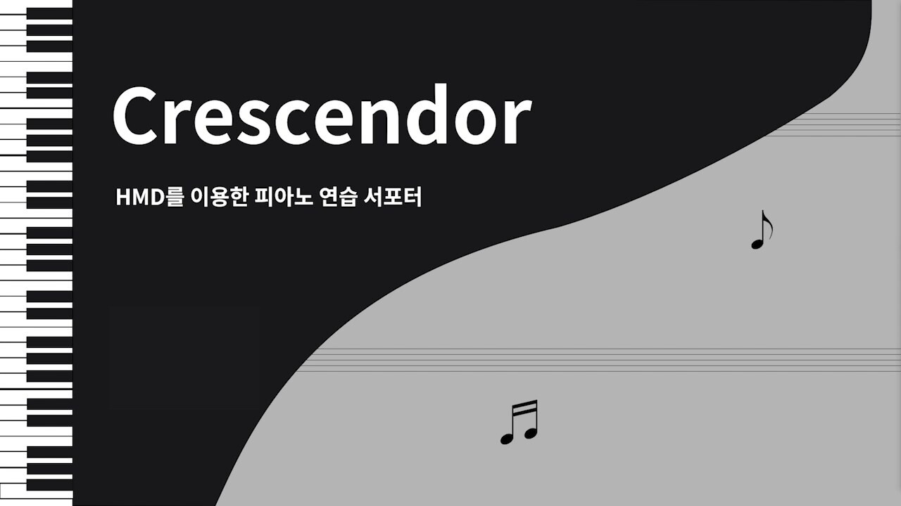
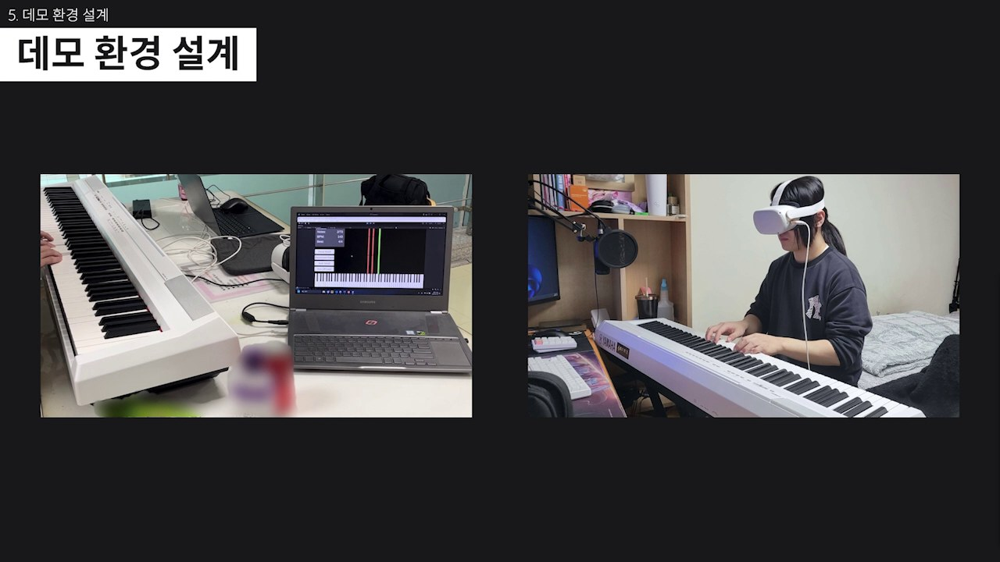
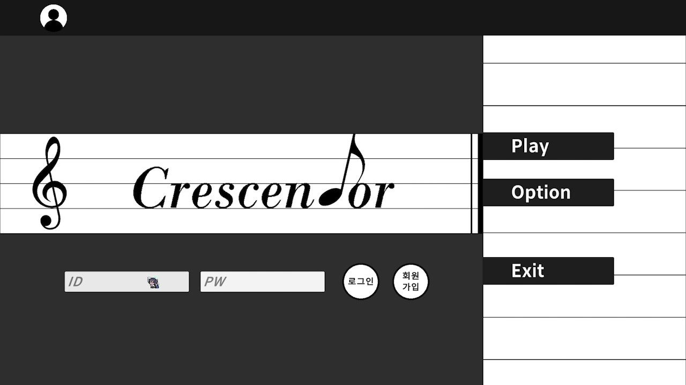
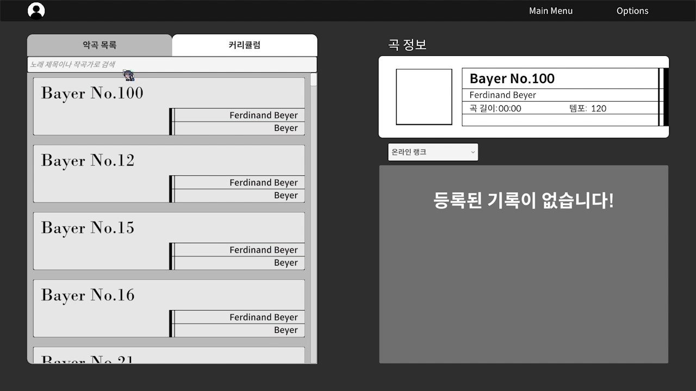
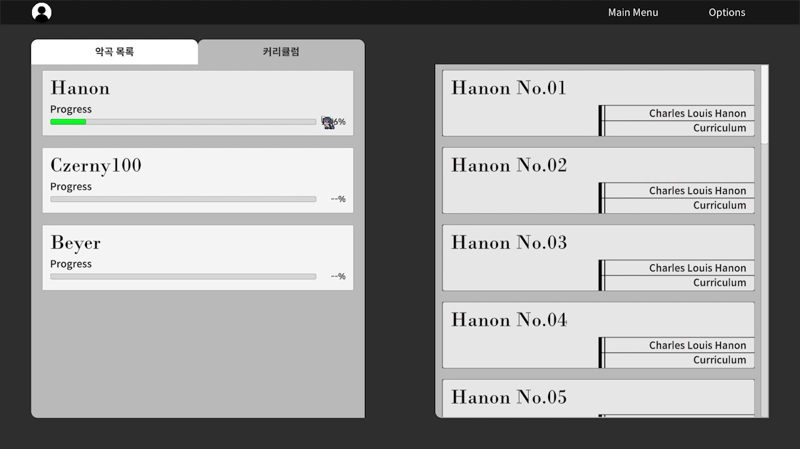
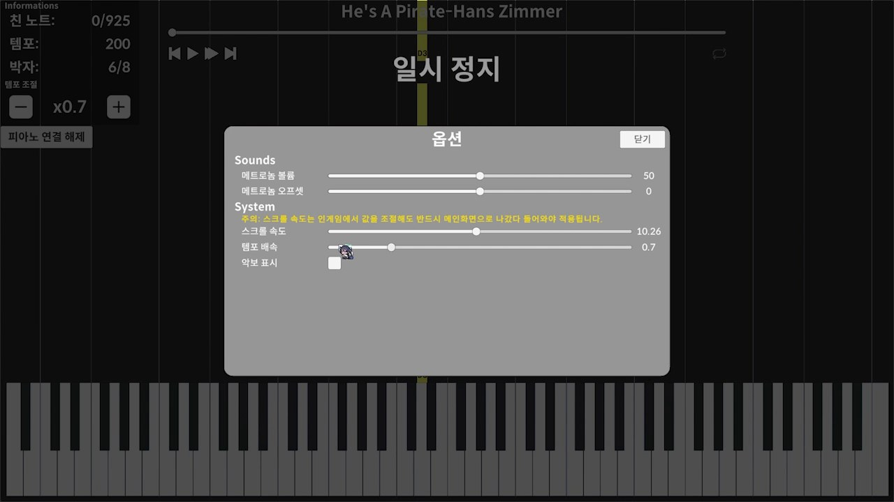
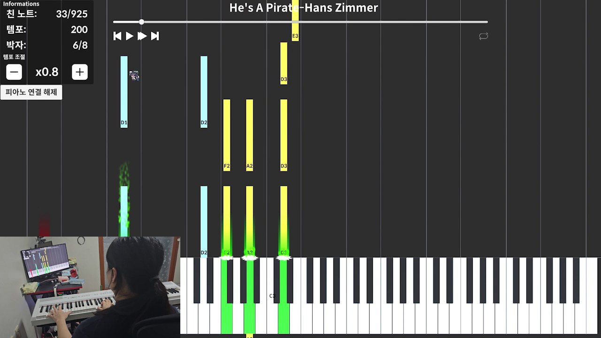
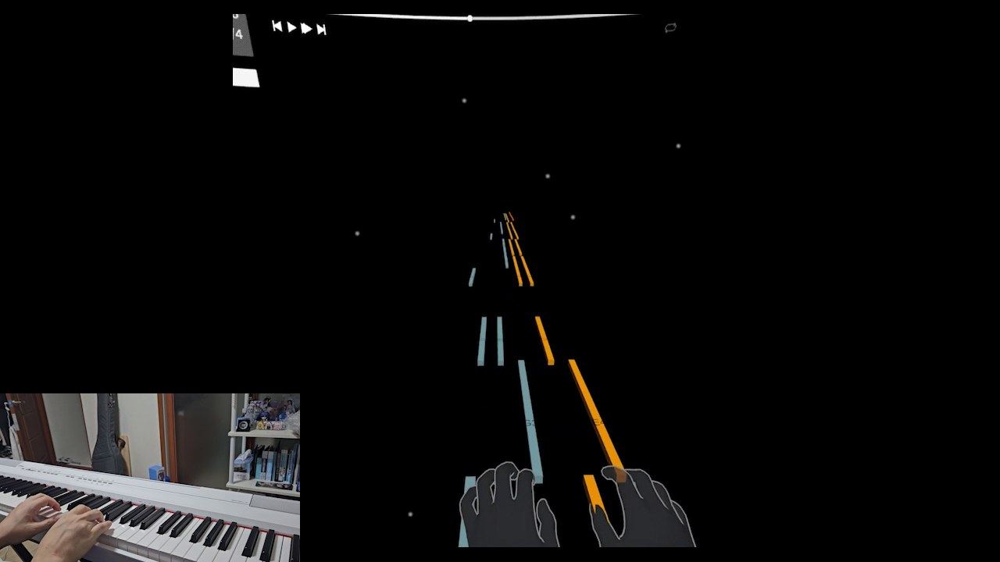
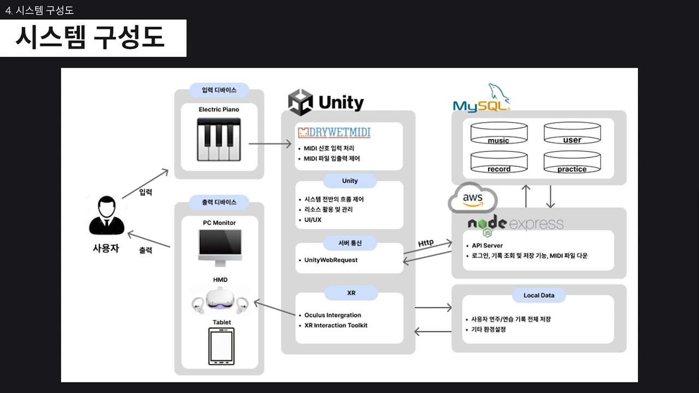

<div align="center">

# 🎹 Crescendor

### HMD를 이용한 피아노 연습 서포터 (졸업 작품)



개발기간 : 2023.09.08 ~ 2024.06.20 (약 9개월)

개발인원 : 4명

사용기술 : Unity, C#, DryWetMIDI, Node.js(Express), MySQL, Oculus(XR Interaction Toolkit)

</div>

<br></br>

# *동영상 / GitHub*

[Crescendor 시연 영상](https://youtu.be/W3biAn-fPuE) · [GitHub](https://github.com/johwoong/Crescendor.git) · [Notion 포트폴리오](https://www.notion.so/2f80c02b964a8187b5fad501b2988d87)

🏆 제24회 한국공학대전 월드클래스기업협회상 수상

# *프로젝트 소개*

피아노 학습을 시작하는 사람들은 악보를 읽는 것이 어렵고, 실력이 늘지 않아 흥미를 잃기 쉽습니다.
Crescendor는 **MIDI 데이터 시각화와 실시간 판정 시스템**으로 악보에 익숙하지 않아도 떨어지는 노트를 따라 연주하며 배울 수 있는 피아노 학습 시스템입니다.
실제 MIDI 피아노를 연결해 PC, 태블릿(Android), VR(Oculus)에서 같은 방식으로 연습할 수 있습니다.

| 구분 | 내용 |
|---|---|
| 개발 배경 | 악보 읽기의 어려움과 학습 과정의 부담으로 흥미를 잃고 포기하는 학습자가 많음 |
| 개발 목표 | MIDI 파일과 XR을 활용해 몰입감 있고 흥미를 유발하는 피아노 교육 시스템 개발 |
| 기대 효과 | 여러 제약사항과 관계없이 많은 사람이 쉽게 피아노를 배울 수 있는 환경 제공 |

# *담당파트*

> 팀 프로젝트(4명)에서 **UI 프레임워크와 메뉴·계정·마이페이지 화면**을 담당했습니다. (Git 커밋 기준: 2024.01 ~ 2024.07)

- ***UI 프레임워크 구조 설계*** (`UI_Base`, `UI_Scene`, `UI_PopUp`, `UI_EventHandler`, `UIManager`)
- ***메인메뉴 / 로그인 / 회원가입 / 회원탈퇴 / 로그아웃***
- ***곡 선택 화면, 곡 리스트 로딩, 랭킹 팝업***
- ***마이페이지*** (프로필 이미지, 학습 달력, 커리큘럼 뱃지)
- ***클라이언트-서버 연동 일부*** (`DataManager`, `SongManager`)

# *게임 주요 사진*

### 시연 환경

실제 전자 피아노를 PC 또는 VR HMD와 연결해 연주합니다.



### 메인 / 곡 선택

 

### 커리큘럼 / 옵션

 

### 연주 화면 (PC / VR)

 

# *구현 컨텐츠 및 기능 설명*

## 1. 시스템 구성



- 입력 디바이스(전자 피아노)의 MIDI 신호를 **DryWetMIDI**로 받아 Unity에서 처리하고, PC 모니터 / HMD / 태블릿으로 출력합니다.
- 곡 목록, 사용자, 연주 기록, 연습 커리큘럼은 **Node.js(Express) + MySQL** 서버에서 관리하며, Unity는 `UnityWebRequest`로 통신합니다.
- PC, Oculus(XR Interaction Toolkit), Android 버전이 각각 `PC/`, `Oculus/`, `Android/` 프로젝트로 나뉘어 있고 서버는 `Server/`에 있습니다.

## 2. 담당 구현 내용

### UI 프레임워크 (UI 자동화)

- `UI_Base`를 공통 부모로 두고 씬 UI(`UI_Scene`)와 팝업 UI(`UI_PopUp`)를 분리했습니다. 버튼·텍스트·이미지 같은 UI 요소를 이름으로 바인딩하고 `UI_EventHandler`로 클릭 같은 이벤트를 연결하는 구조라, 화면마다 반복되던 `Find`/이벤트 등록 코드를 줄였습니다.
- `UIManager`가 현재 씬(`Define.Scene`)을 확인해 해당 씬의 UI 컨트롤러를 자동으로 붙이고, 씬이 바뀌면 이전 컨트롤러를 제거하도록 했습니다.

### 메인메뉴 · 계정

- 메인메뉴 UI와 NavBar를 구성하고, 로그인 상태에 따라 NavBar에 사용자 ID가 표시되도록 했습니다. (`UI_MainMenu`)
- 로그인 / 회원가입 / 회원탈퇴 / 로그아웃을 구현했습니다. 서버와는 `UnityWebRequest` 코루틴으로 통신하고, 실패 시 에러 팝업(`UI_ErrorMsg`)으로 안내합니다. (`UI_SignUp`, `UI_Secession`, `UI_CheckOut`)

### 곡 선택 · 랭킹

- `SongManager`가 변환된 곡 데이터 폴더를 읽어 곡 목록을 만들고, 곡 선택 화면에서 곡 / 커리큘럼 목록을 불러와 표시합니다. (`UI_Select`)
- 곡별 랭킹 팝업(`UI_RankPopUp`)과 곡 정보 팝업(`UI_SongPopUp`)을 구성했습니다.

### 마이페이지

- 프로필 이미지를 URL로 설정·변경하는 기능을 만들었습니다. (`UI_Profile`, `DataManager.SetProfileImage`)
- 연습한 날짜를 서버 로그에서 받아 **달력에 표시(잔디 형태)** 하고, 이전 / 다음 달 이동을 지원합니다. (`UI_MyPage.UpdateCalendar`, `HighlightLogDates`)
- 커리큘럼 진행도에 따라 **뱃지**가 바뀌도록 구현했습니다. (`SetBadge`)

## 3. 팀 구성 및 역할

| 파트 | 주요 내용 |
|---|---|
| **본인** | UI 프레임워크, 메인메뉴·계정, 곡 선택·랭킹 UI, 마이페이지 |
| 팀원 A (`ayuriK152`) | MIDI 파싱·노트 생성, 연습 / 실전 / 리플레이 컨트롤러, 판정·결과 화면, 메트로놈·사운드, 악보 라이브러리 연동 |
| 팀원 B (`golapaduck`) | Express + MySQL 서버, Android 입력(페달 등) 및 이펙트 |
| 팀원 C (`onenewkong`) | Oculus(VR) 버전, 씬 로딩 화면(비동기 로딩) |

> 역할은 Git 커밋 기록을 기준으로 정리한 것입니다.

## 4. 팀 구현 파트 (프로젝트 전체 구조)

### Manager 중심 구조

- 모든 매니저(`Input / Midi / UI / Ingame / Scene / Data / Song / Sound`)를 `@Manager` 오브젝트(`DontDestroyOnLoad`) 아래 `Managers.Xxx` 정적 접근자로 통일했습니다.
- 초기화 순서는 `Managers.Init()` 한 곳에서 관리하고, 씬 로드 때마다 `SceneManagerEx`가 `UI`, `Ingame`을 다시 초기화합니다.

### MIDI 입력 → 노트 판정

- `MidiManager`가 `.mid` 파일을 파싱해 노트(키 번호, 시작/끝 시간, 채널), 템포, 마디 정보를 만들고 노트 오브젝트를 생성합니다.
- `InputManager`가 연결된 피아노의 입력을 실시간으로 받아 현재 연주 시간의 노트와 비교해 판정합니다.
- 공통 로직은 `IngameController`에 두고, `PracticeModController` / `ActualModController` / `ReplayModController`가 상속해 모드별 차이만 구현합니다.

## 5. 랭킹 / 기록 서버

| Method | Endpoint | 설명 |
|---|---|---|
| POST | `/signup`, `/login` | 회원가입 / 로그인 (bcrypt 해시) |
| GET | `/ranking/:music_name` | 곡별 랭킹 |
| GET | `/record/getscore/:user_id/:music_name` | 개인 기록 조회 |
| POST | `/record/addscore/:user_id/:music_name` | 기록 등록 |
| PUT | `/record/setscore/:user_id/:music_name` | 기록 갱신 |
| GET | `/music`, `/practice` | 곡 / 연습곡 목록 |

# *기술적 요소*

- UI 프레임워크 (UI 자동 바인딩, 씬별 컨트롤러 교체)
- 로그인 / 회원 기능 및 서버 연동 (UnityWebRequest)
- 달력 · 뱃지 기반 학습 기록 시각화
- Manager 싱글톤 구조
- MIDI 파싱 / 실시간 입력 판정
- Express + MySQL REST 서버, UnityWebRequest 연동
- XR(Oculus) 핸드 트래킹 기반 VR 연주 화면

# *실행 방법*

### Client
1. Unity Hub에서 `PC/` 폴더를 엽니다. (에디터 버전 `6000.3.24f1`)
2. `Assets/Scenes`의 시작 씬을 열고 Play 합니다.
3. MIDI 피아노를 USB로 연결합니다.

### Server
```bash
cd Server
npm install
# config/database.js 에 DB 접속 정보 설정
node index.js        # 기본 포트 3000
```
